<a href="https://abhayemekar.me">
  <picture>
    <source media="(prefers-color-scheme: dark)" srcset="assets/hero-dark.svg">
    <source media="(prefers-color-scheme: light)" srcset="assets/hero-light.svg">
    
  </picture>
</a>

<p align="center">
  <a href="https://abhayemekar.me"><picture><source media="(prefers-color-scheme: dark)" srcset="assets/link-site-dark.svg"><source media="(prefers-color-scheme: light)" srcset="assets/link-site-light.svg"></picture></a>
  <a href="https://www.linkedin.com/in/abhayyemekar/"><picture><source media="(prefers-color-scheme: dark)" srcset="assets/link-linkedin-dark.svg"><source media="(prefers-color-scheme: light)" srcset="assets/link-linkedin-light.svg"></picture></a>
  <a href="mailto:abhay.s.yemekar@gmail.com"><picture><source media="(prefers-color-scheme: dark)" srcset="assets/link-email-dark.svg"><source media="(prefers-color-scheme: light)" srcset="assets/link-email-light.svg"></picture></a>
</p>

<h3>About</h3>

Full-stack AI engineer in Pune. I build AI products end to end, from the model and the API to the interface people use, and I care most about making them trustworthy: grounded answers, evals in CI, and audit trails.

- **Day job:** software engineer at [Translytics](https://translytics.io), building AI-powered features and backend services for a supply-chain planning platform.
- **On the side:** [HireLens](https://github.com/abhay-yemekar/hirelens) v1.4 (open source, on npm), [yDirect](https://chromewebstore.google.com/detail/ehkahipeoahnbfbahlkedgdcjefejihg) on the Chrome Web Store, and [SearchScribe AI](https://searchscribe-ai.vercel.app) and [ForecastGPT](https://forecastgpt-financial-outlook-agent.onrender.com/), both live.
- **Principle:** model output is untrusted input. Ground it, test it, log it.

Email, ready to copy:

```text
abhay.s.yemekar@gmail.com
```

<h3>Shipped</h3>

<p>
  <a href="https://hirelens-rosy.vercel.app"><picture><source media="(prefers-color-scheme: dark)" srcset="assets/card-hirelens-dark.svg"><source media="(prefers-color-scheme: light)" srcset="assets/card-hirelens-light.svg"></picture></a>
  <a href="https://chromewebstore.google.com/detail/ehkahipeoahnbfbahlkedgdcjefejihg"><picture><source media="(prefers-color-scheme: dark)" srcset="assets/card-ydirect-dark.svg"><source media="(prefers-color-scheme: light)" srcset="assets/card-ydirect-light.svg"></picture></a>
</p>
<p align="center"><sub>
  <b>HireLens</b> &nbsp;<a href="https://hirelens-rosy.vercel.app/demo">live demo</a> · <a href="https://github.com/abhay-yemekar/hirelens">code</a> · <a href="https://www.npmjs.com/package/hirelens">npm</a>
  &nbsp;&nbsp;&nbsp;&nbsp;
  <b>yDirect</b> &nbsp;<a href="https://chromewebstore.google.com/detail/ehkahipeoahnbfbahlkedgdcjefejihg">install</a> · <a href="https://github.com/abhay-yemekar/ydirect">product page</a> · <a href="https://www.linkedin.com/company/ydirect/">LinkedIn</a>
</sub></p>

<p>
  <a href="https://searchscribe-ai.vercel.app"><picture><source media="(prefers-color-scheme: dark)" srcset="assets/card-searchscribe-dark.svg"><source media="(prefers-color-scheme: light)" srcset="assets/card-searchscribe-light.svg"></picture></a>
  <a href="https://forecastgpt-financial-outlook-agent.onrender.com/"><picture><source media="(prefers-color-scheme: dark)" srcset="assets/card-forecastgpt-dark.svg"><source media="(prefers-color-scheme: light)" srcset="assets/card-forecastgpt-light.svg"></picture></a>
</p>
<p align="center"><sub>
  <b>SearchScribe AI</b> &nbsp;<a href="https://searchscribe-ai.vercel.app">live</a> · <a href="https://github.com/abhay-yemekar/SearchScribe_AI_Studio">code</a>
  &nbsp;&nbsp;&nbsp;&nbsp;
  <b>ForecastGPT</b> &nbsp;<a href="https://forecastgpt-financial-outlook-agent.onrender.com/">live</a> · <a href="https://github.com/abhay-yemekar/forecastgpt-financial-outlook-agent">code</a>
</sub></p>

<p>
  <a href="https://github.com/abhay-yemekar/ycorrect"><picture><source media="(prefers-color-scheme: dark)" srcset="assets/card-writeright-dark.svg"><source media="(prefers-color-scheme: light)" srcset="assets/card-writeright-light.svg"></picture></a>
  <a href="https://github.com/abhay-yemekar/reflex-ai"><picture><source media="(prefers-color-scheme: dark)" srcset="assets/card-reflex-dark.svg"><source media="(prefers-color-scheme: light)" srcset="assets/card-reflex-light.svg"></picture></a>
</p>

<details>
<summary><b>Earlier work</b>: internships and first projects</summary>
<br>

| Project | What it does | Built with |
|---|---|---|
| [3-Factor Login](https://github.com/abhay-yemekar/Modern-Online-Banking-Authentication-System-using-AI) <sub>BitMap Technology, 2023</sub> | Face, then email OTP, then a voice phrase, with liveness detection against photo and screen replays. About 95% correct identification and 88% of spoof attempts blocked in testing. | Python, OpenCV, TensorFlow, Tkinter |
| [CricketStat Pro](https://github.com/abhay-yemekar/CricketStat-Pro-Data-Engineering-Visualization-Project-Using-Python-and-Power-BI) <sub>PHN Technology, 2023</sub> | T20 World Cup 2022 analytics: scraped all 45 matches from ESPNcricinfo, modelled a star schema and built a Power BI report to pick a data-driven Playing XI. | Python, pandas, Bright Data, Power BI, DAX |
| [News-to-Video Generator](https://github.com/abhay-yemekar/Flask-Web-App-News-Video-Generator) <sub>2025</sub> | Turns headlines and images into narrated MP4 news videos, behind Google sign-in. | Flask, OAuth 2.0, MoviePy, Pillow |

</details>

<h3>Capabilities</h3>

<picture>
  <source media="(prefers-color-scheme: dark)" srcset="assets/capabilities-dark.svg">
  <source media="(prefers-color-scheme: light)" srcset="assets/capabilities-light.svg">
  
</picture>

<sub>Also from my resume and day job: C for embedded and RTOS work, Git and Jira workflows, a Kafka bootcamp, and AWS and Azure fundamentals.</sub>

<h3>Signal</h3>

<picture>
  <source media="(prefers-color-scheme: dark)" srcset="assets/signal-dark.svg">
  <source media="(prefers-color-scheme: light)" srcset="assets/signal-light.svg">
  
</picture>

<sub>Personal account only; day-job work lives in a private organisation. Every number is pulled from the GitHub and npm APIs and redrawn daily by <a href=".github/workflows/refresh.yml">a workflow</a>.</sub>

<h3>Path</h3>

<picture>
  <source media="(prefers-color-scheme: dark)" srcset="assets/path-dark.svg">
  <source media="(prefers-color-scheme: light)" srcset="assets/path-light.svg">
  
</picture>

<br>
<p align="center"><sub>Every image here is generated from <a href="content.toml">content.toml</a> and live API data by <a href="scripts">scripts/</a>. Logos from <a href="https://simpleicons.org">Simple Icons</a>.</sub></p>
